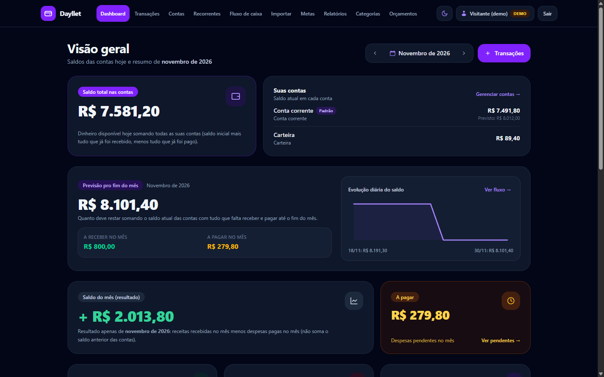
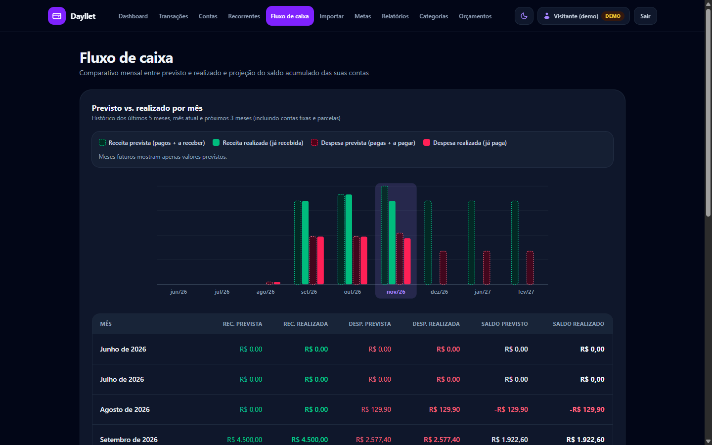
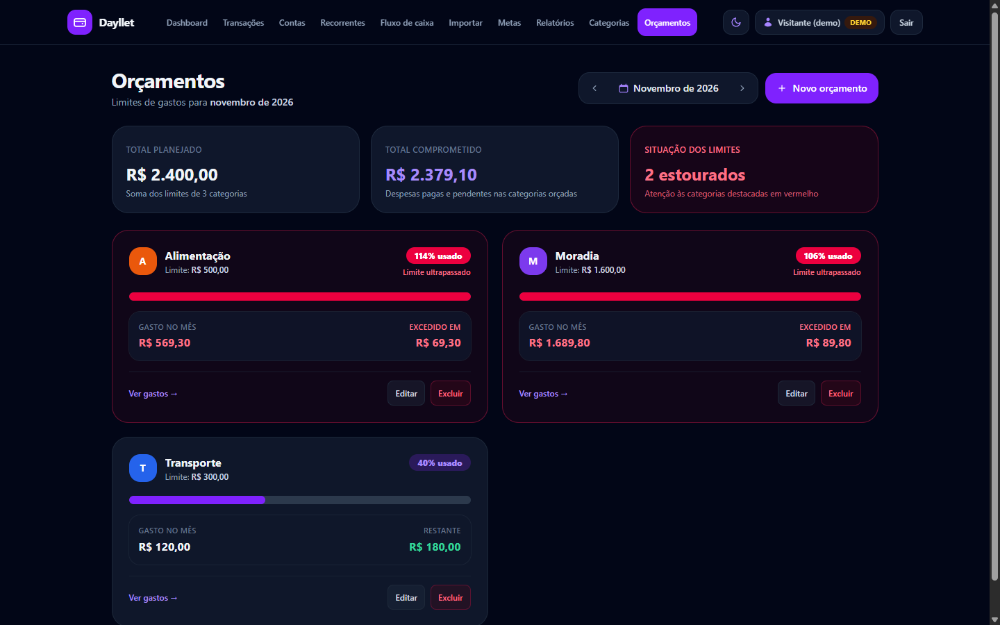
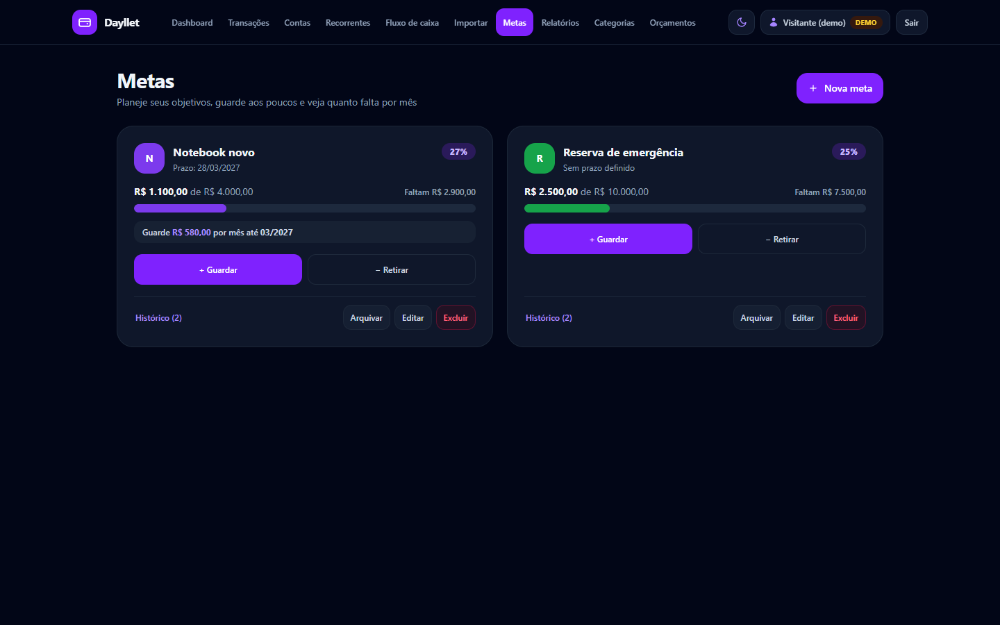
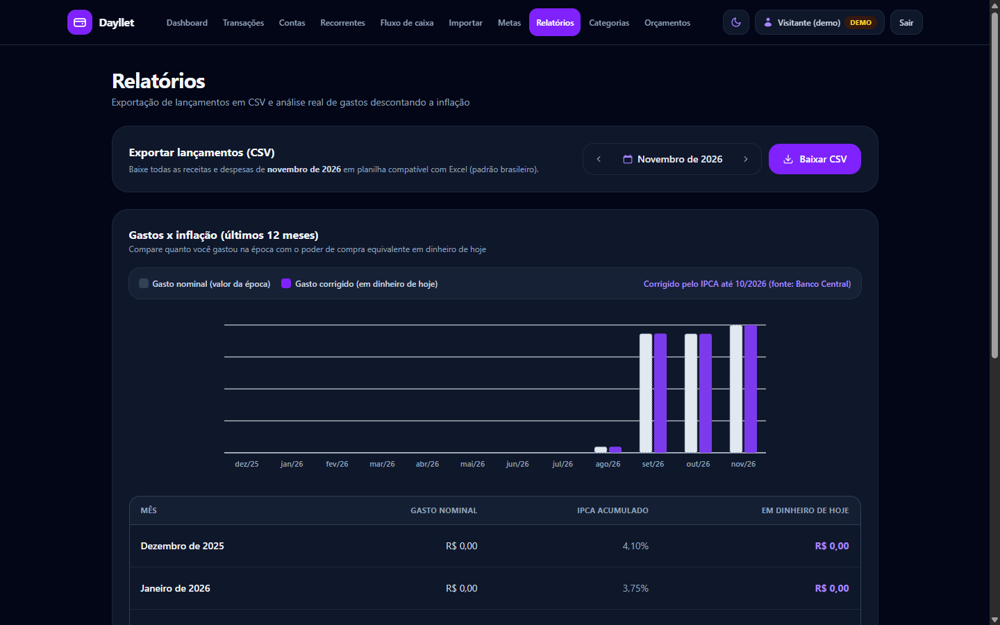
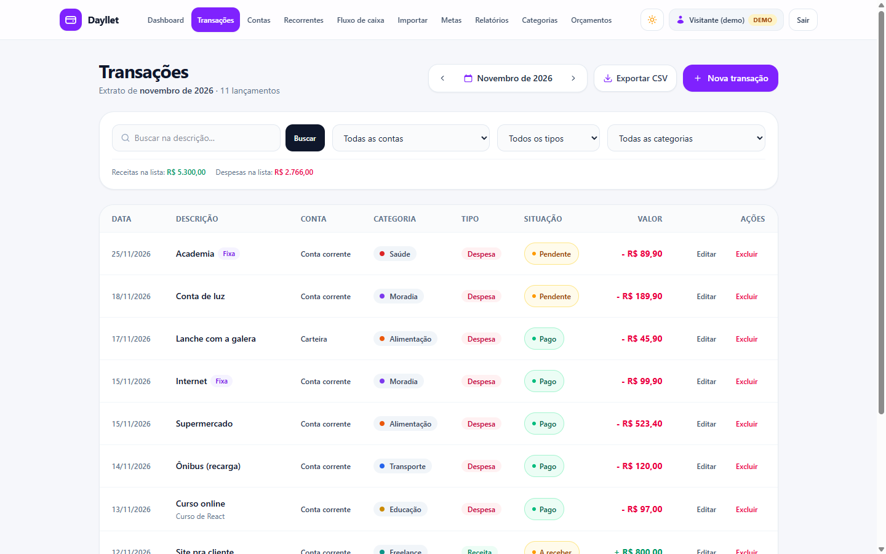
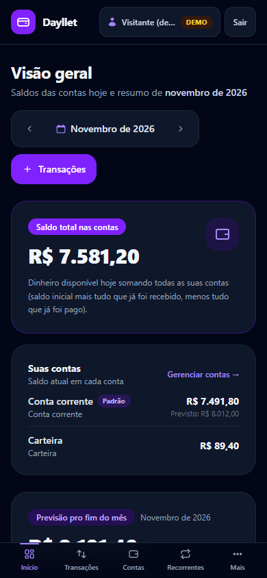

<div align="center">



# Dayllet

**Finanças pessoais do dia a dia, em português.** Contas, gastos, previsão do mês, extrato do banco e metas num lugar só.

[](https://github.com/welessonOliveira/dayllet/actions/workflows/ci.yml)


### [▶ Testar agora: dayllet.vercel.app](https://dayllet.vercel.app)

Clique em **"Entrar como visitante"**: você ganha uma conta só sua, com dados de exemplo, que some em 24h. Ou entre com Google/GitHub e use de verdade.

</div>

---

**Dayllet** (day + wallet) vai além do "CRUD de receitas e despesas": tem várias contas, contas fixas e parcelamentos que se lançam sozinhos, projeção do saldo, importação de extrato bancário (Nubank incluso) com categorização automática, metas, relatórios corrigidos pela inflação, modo escuro e instala no celular como app. É multiusuário, e cada pessoa só enxerga os próprios dados.

## Telas

| Fluxo de caixa | Orçamentos |
|---|---|
|  |  |
| **Metas** | **Relatórios (IPCA)** |
|  |  |
| **Transações (modo claro)** | **No celular** |
|  |  |

## Destaques técnicos

- **Multiusuário seguro:** toda função do servidor recebe `{ db, userId }` da sessão e filtra por ele; testes de IDOR garantem que ninguém lê dado de outro.
- **Dinheiro em centavos inteiros** (nada de float) e correção pelo IPCA com `BigInt`; datas em UTC com mês calculado no fuso de São Paulo.
- **Contas fixas idempotentes:** geradas "na leitura" com chave única por ocorrência, sem cron e sem duplicar.
- **Importação com revisão:** OFX (inclusive SGML dos bancos brasileiros) e CSV, deduplicação por id do banco/hash, desfazer importação.
- **Qualidade:** 173 testes (Vitest, unitários + integração em PostgreSQL de verdade) rodando no CI a cada push.
- **LGPD:** baixar todos os dados em JSON e excluir a conta na hora.

> Especificação e decisões: [`docs/PROMPT.md`](docs/PROMPT.md). Funções e actions disponíveis pras telas: [`docs/CONTRATO.md`](docs/CONTRATO.md).

## Funcionalidades

| Área | O que faz |
|---|---|
| **Login** | Google, GitHub ou visitante (demo própria, apagada em 24h). |
| **Contas** | Conta corrente, poupança e carteira (ex.: Nubank, PicPay), com saldo inicial, saldo atual e saldo previsto até o fim do mês. Transferência entre contas. |
| **Lançamentos** | Receitas e despesas pagas ou pendentes, com filtros por mês, tipo, categoria, conta e texto. |
| **Contas fixas e parcelados** | Aluguel todo dia 10, assinatura anual, celular em 12x: os lançamentos são criados sozinhos, sem duplicar. Editar ou pausar vale só daqui pra frente. |
| **Projeção** | "Vai sobrar R$ X no fim do mês", aviso de saldo negativo e de contas atrasadas, previsto vs. realizado mês a mês e saldo dos próximos meses. |
| **Importação de extrato** | OFX (inclusive o SGML dos bancos brasileiros) e CSV (conta e fatura do Nubank), com área de revisão, detecção de duplicatas e opção de desfazer. |
| **Categorização automática** | Aprende com as escolhas do usuário ("UBER TRIP" vira Transporte) e sugere na importação e no formulário. |
| **Orçamentos** | Limite mensal por categoria, com alerta quando estoura. |
| **Metas** | "Notebook: R$ 4.000 até março", com quanto guardar por mês. |
| **Relatórios** | Exportação CSV pro Excel e gastos corrigidos pelo IPCA (API do Banco Central). |
| **Visual** | Modo claro, escuro ou automático; instala no celular (PWA); acessível por teclado. |

## Pré-requisitos

- Node.js 22 (ou mais novo) e npm.
- PostgreSQL 17 rodando localmente, com dois bancos: `financas_dev` e `financas_test`. Pode ser o instalador oficial, Docker ou um banco no Neon.

Se o Postgres foi instalado sem serviço do Windows (só os binários), dá pra ligar e desligar por aqui:

```bash
npm run db:start    # liga o Postgres local
npm run db:status   # confere se está no ar
npm run db:stop     # desliga
```

Se o Postgres estiver em outra pasta, defina `PG_HOME` antes de usar esses comandos.

## Instalação

```bash
npm install                     # também roda o `prisma generate`
cp .env.example .env            # no Windows: copy .env.example .env
# edite o .env: senha do Postgres e AUTH_SECRET (gere com: npx auth secret)
npx prisma migrate deploy       # cria as tabelas
npm run db:seed                 # cria a conta demo com dados de exemplo
npm run dev                     # http://localhost:3000
```

### Login

- **Conta demo:** botão "Entrar como visitante (demo)". **Cada visitante ganha uma conta demo só dele**, com dados de exemplo (contas fixas, um parcelado, metas, transferência e regras de categoria), que é apagada depois de 24 horas. Um visitante nunca vê o que outro fez. O `npm run db:seed` cria uma demo fixa (`demo@financas.local`) pra desenvolvimento.
- **Google (opcional):** crie um cliente OAuth "Aplicativo da Web" no Google Cloud (Google Auth Platform) com callback `http://localhost:3000/api/auth/callback/google` e preencha `AUTH_GOOGLE_ID` e `AUTH_GOOGLE_SECRET`.
- **GitHub (opcional):** crie um OAuth App em https://github.com/settings/developers com callback `http://localhost:3000/api/auth/callback/github` e preencha `AUTH_GITHUB_ID` e `AUTH_GITHUB_SECRET` no `.env`. Sem as chaves, o botão daquele login não aparece. Google e GitHub com o mesmo e-mail caem na mesma conta.
- Usuário novo ganha as categorias padrão e uma conta ("Conta principal").

Pra testar a importação, use os extratos fictícios em `public/exemplos/` (`extrato-exemplo.ofx` e `.csv`).

## Comandos

| Comando | O que faz |
|---|---|
| `npm run dev` | Sobe o app em modo desenvolvimento |
| `npm run build` / `npm run start` | Build de produção e roda o build |
| `npm run lint` | ESLint (`next lint`) |
| `npm run test` | Vitest: testes unitários + integração (usa o banco `financas_test`, que é apagado e recriado) |
| `npx tsc --noEmit` | Checagem de tipos |
| `npm run db:migrate` | `prisma migrate dev` (veja a nota sobre migrations no `CLAUDE.md`) |
| `npm run db:seed` | Recria a conta demo. Pode rodar quantas vezes quiser: não duplica e não mexe em outros usuários. |
| `npm run db:studio` | Prisma Studio pra ver os dados |

## Deploy (Vercel + Neon)

1. Suba o código pro GitHub e importe o repositório na [Vercel](https://vercel.com) (Add New → Project). Ela usa o script `vercel-build`, que aplica as migrations antes do build.
2. No projeto da Vercel: **Storage → Create Database → Neon** (plano grátis) e conecte ao projeto. Isso cria sozinho as variáveis `DATABASE_URL` (com pooler, usada pelo app) e `DATABASE_URL_UNPOOLED` (direta, usada pelas migrations).
3. Em **Settings → Environment Variables**, adicione `AUTH_SECRET` (gere com `npx auth secret` ou `openssl rand -base64 32`).
4. Faça o redeploy. A conta demo é criada sozinha no primeiro "Entrar como visitante".
5. Opcional, login com GitHub: um OAuth App novo com o callback `https://SEU-APP.vercel.app/api/auth/callback/github`, mais `AUTH_GITHUB_ID` e `AUTH_GITHUB_SECRET`.

## Arquitetura

Monolito modular em Next.js 15 (App Router). As regras de negócio ficam separadas da tela e do banco:

```
prisma/              schema, migrations e seed
src/middleware.ts    manda pro /login quem não tem sessão
src/app/             telas (App Router), /api/auth (Auth.js) e /api/export (CSV)
src/components/      componentes reutilizáveis
src/lib/             regras PURAS, sem banco (fáceis de testar)
  money.ts           centavos <-> "R$ 1.234,56"
  dates.ts           mês/fuso America/Sao_Paulo <-> UTC
  validations.ts     schemas Zod (cliente e servidor)
  rules.ts           saldo do mês, saldo da conta, orçamento
  recurrence.ts      datas das ocorrências (dia 31, 29/02) e divisão de parcelas
  projection.ts      previsto vs. realizado, saldo dia a dia
  statement.ts       leitura de OFX/CSV
  categorize.ts      regras de categorização
  goals.ts           progresso de metas
  ipca.ts, csv.ts    inflação e exportação
src/server/          acesso ao banco, sempre com o contexto { db, userId }
  auth.ts, session.ts         login (Auth.js v5) e contexto do usuário logado
  wallets.ts, transactions.ts, categories.ts, budgets.ts, dashboard.ts
  recurring.ts       geração idempotente das contas fixas/parcelas
  forecast.ts        projeção e fluxo de caixa
  imports.ts, categoryRules.ts   importação de extrato e regras aprendidas
  goals.ts, reports.ts, indexRates.ts
  demo.ts, defaults.ts           conta demo e dados de usuário novo
  actions/           Server Actions finas: conferem a sessão, validam, chamam src/server
tests/               Vitest: unit/ (regras puras) e integration/ (Postgres de verdade)
```

### Decisões técnicas que valem destacar

- **Dinheiro em centavos** (inteiro), sempre. Divisão de parcelas com a última levando o resto (R$ 100 em 3x = 33,33 + 33,33 + 33,34) e correção pela inflação com `BigInt`. Nada de float.
- **Fuso horário:** datas em UTC no banco e contas de "mês" no fuso de São Paulo. Data sem hora é gravada às 12:00 UTC, então nunca muda de dia.
- **Isolamento entre usuários:** toda função de `src/server` recebe `{ db, userId }` e filtra pelo usuário **da sessão**. Há testes que tentam ler, editar e apagar dados de outro usuário (IDOR) em cada módulo.
- **Server Actions conferem a sessão** antes de qualquer coisa, porque são endpoints públicos.
- **Recorrência sem cron:** os lançamentos são gerados na leitura e são idempotentes por um índice único `(regra, data da ocorrência)`. Duas abas abertas ao mesmo tempo não duplicam. Ocorrência apagada vira um "pulo" e não volta.
- **Importação segura:** nada entra antes da revisão. Importar o mesmo lançamento duas vezes é impossível pelo índice único `(conta, FITID/hash)`, e o mesmo arquivo é barrado pelo SHA-256.
- **CSV injection:** texto exportado que começa com `=`, `+`, `-` ou `@` é neutralizado antes de ir pro Excel.
- **Cabeçalhos de segurança** (`X-Frame-Options`, `nosniff`, `Referrer-Policy`, `Permissions-Policy`).
- **Calculado na hora, nunca guardado:** saldos, projeções e progresso de orçamento e de meta.

### Testes

Mais de 160 testes, entre regras puras e integração com Postgres de verdade. Cobrem dinheiro, datas, recorrência, parcelas, projeção, leitura de OFX/CSV, categorização, metas, IPCA e CSV, e incluem testes de isolamento entre usuários em todos os módulos.

```bash
npm run test
```
